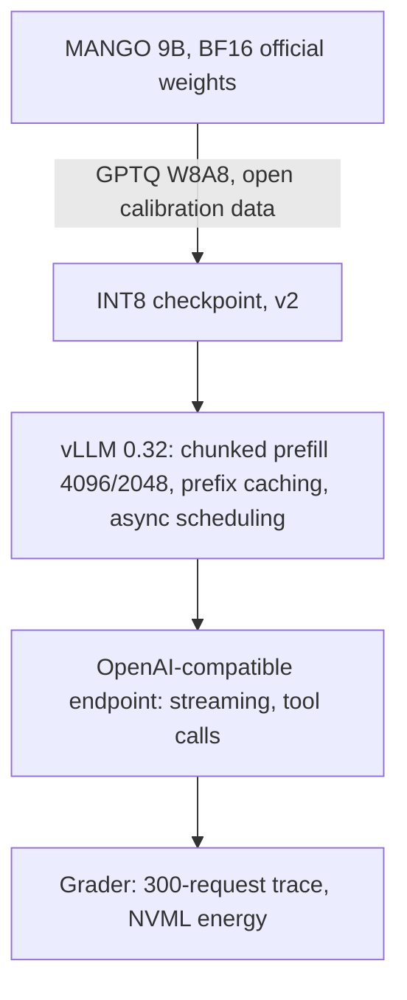
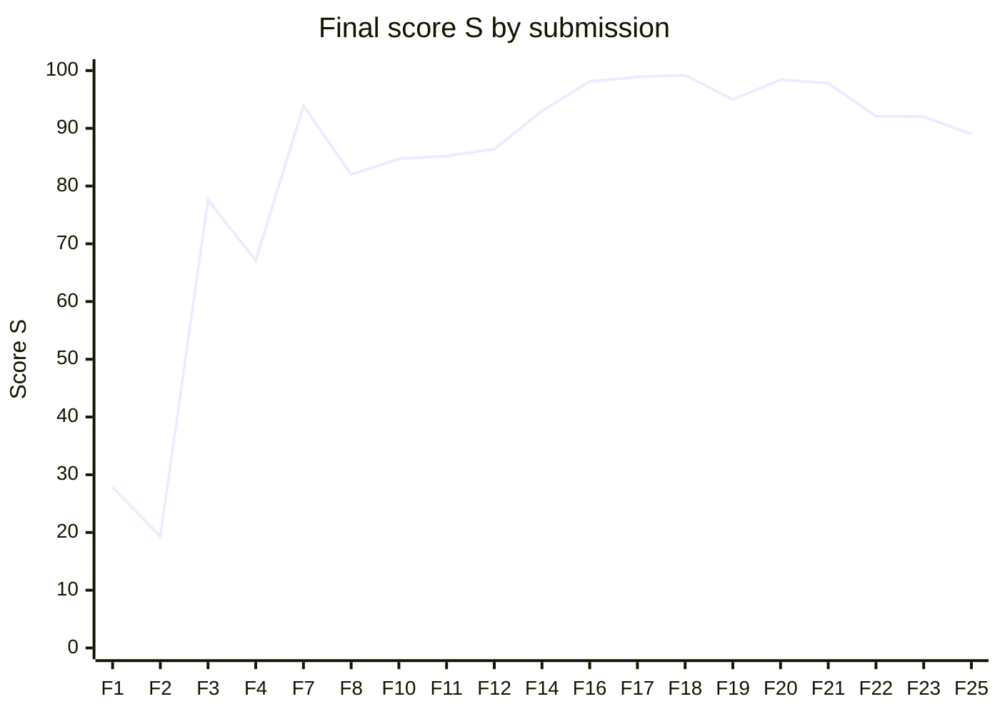

# GreenMind: 3.4× more on-time answers per joule from one A100

Energy-efficient serving of **[CMKL/MANGO1.5-Qwen3.5-9B](https://huggingface.co/CMKL/MANGO1.5-Qwen3.5-9B)**, a 9B hybrid reasoning model, on a single NVIDIA A100 40GB with vLLM.
Built in one day for the **GreenMind LLM Inference Optimization Hackathon** (CMKL University) by Team 08.

**Best Final score: 99.2 / 100.** Same GPU, same model, no retraining. Energy per on-time answer went from **~613 J to ~180 J (−71%)** with no loss in accuracy.

[ภาษาไทย](README.th.md) · [Quantized weights on Hugging Face](https://huggingface.co/chinnakrub/MANGO1.5-Qwen3.5-9B-W8A8-GDN-team08)

## Results

Best Final run (F18), measured by the organizers' grader on a hidden 300-request trace:

| Metric | Baseline (vLLM defaults, BF16) | This repo |
|---|---|---|
| **Score S** | 0 (by definition) | **99.2** |
| On-time answers per joule | 1.00× | **3.41×** (full marks at 3×) |
| Energy per on-time answer | ~613 J | **~180 J** |
| Macro accuracy | 87.8% | **88.1%** (A = 1.00) |
| On-time requests | — | **284 / 300** |
| p95 time to first token | — | **0.81 s** |
| p95 time per output token | — | **44 ms** (target ≤ 50 ms) |

## The challenge

- **Model:** MANGO1.5-Qwen3.5-9B is a hybrid. Only 8 of its 32 layers use full attention with a KV cache. The other 24 are Gated DeltaNet (linear attention) layers that keep a fixed-size state.
- **Hardware:** one A100-SXM4 40GB, 16 vCPU, 48 GB RAM.
- **Traffic:** the grader replays 300 hidden requests open-loop: a ramp, a **4 req/s peak**, then a quiet phase. The mix is chat, RAG over long documents, multi-turn tool calling, math and code, Thai, and up to 32K-token contexts. **Thinking mode is on**, `max_tokens` is 8192 and temperature is 0.
- **On time** means the response streamed, had no error, was not cut off at 8192 tokens, met TTFT ≤ 0.5 s + 0.25 s per 1K prompt tokens, and met TPOT ≤ 50 ms.
- **Score:** `S = 100 · A · s_E^0.6 · s_T^0.2 · s_L^0.2`. Energy carries the most weight. It is measured as on-time requests per GPU joule from the NVML counter, **idle time included**. Late requests still burn energy but count for nothing.

## What worked



### 1. Diagnose the bottleneck, then quantize to INT8 (27.8 → 77.6)
At peak, each scheduler step mixes decode for 60–75 running requests with prefill chunks of up to 4K tokens. That is **compute-bound** work.
4-bit AWQ shrank the weights but still multiplied in FP16, and peak TPOT stayed at 79 ms. **INT8 W8A8** runs on the A100's INT8 tensor cores (624 TOPS against 312 TFLOPS for BF16). We quantized it ourselves from the official weights with GPTQ in about 20 minutes. Peak TPOT dropped to 47 ms and accuracy held.

### 2. Measure before fixing: prefill, not queueing (77.6 → 93.9)
vLLM's `/metrics` showed TTFT was **19 ms of queueing and 154 ms of prefill**. Long RAG and long-context prompts were taking the whole prefill budget while short chats waited behind them.
`--long-prefill-token-threshold 2048` caps each long prompt at half of the 4096-token step budget, so short prompts get scheduled in the same step. p95 TTFT went from 1.28 s to 0.86 s.

### 3. INT8 for the linear-attention layers + async scheduling (93.9 → 99.2)
v1 left the 24 Gated DeltaNet layers in BF16. **v2** quantizes their large projections (`in_proj_qkv`, `in_proj_z`, `out_proj`, 72 modules). It keeps the small gate projections (`in_proj_a`, `in_proj_b`) and `lm_head` in BF16 to protect accuracy. Together with `--async-scheduling`, TPOT went from 47 to 44 ms and energy from ~240 to ~171 J per request.

### 4. Leave the power cap alone
On v2, power limits of 330, 370 and 400 W all landed at 171–176 J per request, because the GPU averages well below any of those caps. 400 W gave the fastest peak. The savings come from software, not from throttling the GPU.

## Score progression

Every Final submission, in order. F18 is the best run.



| Run | Change | S | Efficiency | J / request | p95 TTFT | p95 TPOT | On time |
|---|---|---|---|---|---|---|---|
| F1 | AWQ 4-bit (organizer-provided) | 27.8 | 1.37× | 187 | 2.21 s | 79 ms | 125 |
| F2 | AWQ, max-num-seqs 512 → 192 | 19.3 | 1.19× | 210 | 2.46 s | 82 ms | 122 |
| F3 | **INT8 W8A8 v1 (ours)** | 77.6 | 2.29× | 225 | 1.28 s | 47 ms | 252 |
| F4 | v1 + MTP speculative decoding | 67.1 | 2.08× | 219 | 1.59 s | 47 ms | 223 |
| F7 | v1 + **long-prefill threshold 2048** | 93.9 | 2.76× | 211 | 0.86 s | 45 ms | 285 |
| F16 | **INT8 v2 + async scheduling**, 370 W | 98.1 | 3.30× | 176 | 0.82 s | 44 ms | 284 |
| F17 | same, 330 W | 98.9 | 3.37× | 172 | 0.97 s | 45 ms | 283 |
| **F18** | **same, 400 W** | **99.2** | **3.41×** | **171** | **0.81 s** | **44 ms** | **284** |

The full log, including every Validation run and every repeat, is in [README.th.md](README.th.md).

## What did not work

| Tried | Result | Why |
|---|---|---|
| Scheduler tuning on BF16 | 0.90× → 0.97× | The GPU was already saturated |
| Fewer concurrent sequences (512 → 192) | 27.8 → 19.3 | The bottleneck was compute per step, not queue depth |
| AWQ 4-bit | TPOT 79 ms | Smaller weights, but the matmuls still run in FP16 |
| MTP speculative decoding | 77.6 → 67.1 | Verifying drafted tokens took compute at peak, when it was scarcest |
| Prefill budget 8192 | 89.0 | Activation memory shrank the KV cache to 631K tokens and the prefix hit rate fell to 18% |
| Long-prefill threshold 1024 | Validation 65.5 | Prefix hit rate fell to 16%, at 346 J per request |
| Small/large model router, prompt compression | Not built | Breaks the single-process rule. Decode dominates the work anyway (one example: 19 prompt tokens vs 312 output tokens) |

## Findings worth knowing

- **On this hybrid model, prefix caching depends on prefill chunk size.** A 4096 budget with a 2048 threshold kept the prefix hit rate at ~47–51%. Both 1024 and 8192 collapsed it to 16–18%, which drove up energy and TTFT.
- **Run-to-run variance is large.** The same config scored 92–99.2. Even at temperature 0, batch composition changes the numerics, so accuracy moved between 0.959 and 1.004 of baseline. About 2% of requests think past 5,000 tokens. They stretch the end of a run by 115–160 s at ~200 W on a nearly idle GPU, and are usually wrong anyway.
- **The first Final after a restart tends to use more energy** (216–218 J/request in 3 of 4 cases). Warm the server up and don't restart between runs.
- **Validation does not predict Final.** Energy per request on Validation ranged from 241 to 346 J for the same model.
- **What's left is reasoning length.** Serving-side tuning cannot remove the long-thinking tail. Concise-reasoning fine-tuning on open data is the next step.

## Reproduce

```bash
# 1. Environments (vLLM and llm-compressor kept apart)
uv venv ~/venv --python 3.12 && source ~/venv/bin/activate
uv pip install -r requirements/serve.txt
uv venv ~/venv-quant --python 3.12 && source ~/venv-quant/bin/activate
uv pip install -r requirements/quant.txt

# 2. Official weights
hf download CMKL/MANGO1.5-Qwen3.5-9B --local-dir /models/mango-bf16

# 3. Quantize (~15 min on one A100), then copy the processor files vLLM needs
TOKENIZERS_PARALLELISM=false python quant/quant_w8a8_gdn.py
quant/post_quant.sh /models/mango-w8a8-gdn

# 4. Serve, then warm up before any measured run
./serve_best.sh
python tools/warmup.py
```

Or skip step 3 and download the [quantized weights](https://huggingface.co/chinnakrub/MANGO1.5-Qwen3.5-9B-W8A8-GDN-team08) directly.
FlashInfer kernels need `nvcc` on the first start. If vLLM fails with `Could not find nvcc`, install the CUDA 12.9 toolkit and set `CUDA_HOME`.

## Repository layout

```
serve_best.sh            vLLM command for the best run (F18)
serve_final.sh           same, with gpu-memory-utilization 0.95 (last submissions)
quant/
  quant_w8a8.py          v1: INT8 for MLP and full attention
  quant_w8a8_gdn.py      v2: adds the linear-attention projections (used for 99.2)
  post_quant.sh          copies processor files into the quantized checkpoint
tools/
  warmup.py              warms kernels and CUDA graphs after a restart
  loadtest.py            grader-shaped open-loop load test with NVML energy
sim/
  sim.py, sweep2.py      step-level simulator of vLLM chunked prefill and power capping
  mc_real.py             Monte Carlo over the real Final results
logs/                    vLLM metrics and engine stats from the F16–F18 runs
requirements/            pip requirements for serving, quantization and tools
```

## Measuring without spending grader submissions

The grader allowed two Final runs per hour, so most decisions were made offline:

- **`tools/loadtest.py`** replays a grader-shaped trace with the same class mix and reports on-time rate, p95 TTFT and TPOT, joules from NVML, and why each failed request failed.
- **`sim/sim.py`** is a step-level simulator of vLLM's chunked-prefill scheduler and the GPU power cap, calibrated against the VM (287 vs 284 on time, p95 TPOT 41 vs 39–47 ms). It showed that 375 W costs more on-time requests than it saves in energy. It does not model prefix-cache hit rate, which is why it missed the threshold-1024 regression.
- **`sim/mc_real.py`** resamples the real Final results. It estimated the chance of beating 99.2 in a single run at ~6.5%, and showed that on-time rate at peak is the factor that moves it most.

## Rules compliance

- The model is derived from the official weights by post-training quantization only, done during the event.
- Calibration data is open: `HuggingFaceH4/ultrachat_200k` (384 samples) and `airesearch/WangchanThaiInstruct` (128 samples), so Thai stays in range. No hidden test items were used, and request contents were never logged.
- All software is open source: vLLM, llm-compressor, transformers, FlashInfer.
- One vLLM process on one GPU. No response caching, only vLLM's prefix caching, which the rules allow. The power limit was held constant within each run, and the grader-controlled sampling settings were not overridden.

## Stack

vLLM 0.32 · llm-compressor (GPTQ W8A8) · CUDA 12.9 · FlashInfer · FlashAttention 2 · Triton/FLA kernels for Gated DeltaNet · NVIDIA A100-SXM4 40GB · Ubuntu 24.04
